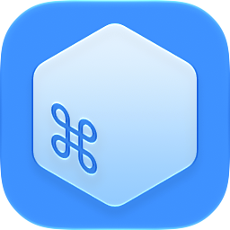
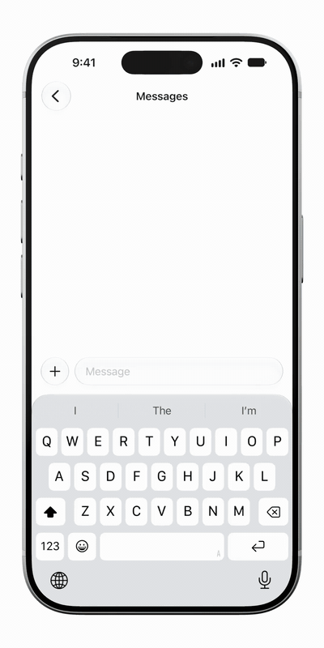

<p align="center">
  
</p>

# Hielo
Hielo adds a few handy keyboard utilities for SwiftUI, including a popover that you can present over the system keyboard.

## Features
- Present a Liquid Glass popover over the system keyboard.
- Read the live keyboard height.

You can use these utilities to, for example, create an effect similar to the Messages app's media attachments picker.



> [!WARNING]
> Presenting a popover over the keyboard requires some private APIs, which are lightly obfuscated. Use at your own risk. The keyboard-height utility (`onHieloKeyboardHeightChange`) uses only public API.

### Why "Hielo"?
Glad you asked! To present popovers above the keyboard, Hielo uses some private APIs to freeze the system keyboard and present content above said frozen copy, giving the illusion that the keyboard is still there. Frozen → Ice → Hielo.

# Usage

### Requirements

- iOS 26 or later
- Swift 6.2 or later
- Xcode 26 or later

### Installation

In Xcode, choose **File → Add Package Dependencies** and enter:

```text
https://github.com/laurasandoval/Hielo
```

## Presenting a Popover

To present a popover:
1. Apply `.hieloHost()` to the parent view.
2. Use `.hieloPopover` on the popover's source view. This API is purposefully built to be as similar as possible to Apple's own `.popover` and `.sheet` APIs.

```swift
import Hielo
import SwiftUI

struct ChatView: View {
  @State private var isMenuPresented = false
  @FocusState private var inputIsFocused: Bool

  var body: some View {
    VStack {
      Spacer()

      Button("Open menu", systemImage: "plus") {
        isMenuPresented = true
      }
      .frame(width: 48, height: 48)
      .hieloPopover(
        isPresented: $isMenuPresented,
        attachmentAnchor: .leading
      ) {
        Text("Hello World")
          .frame(width: 250, height: 250)
      }

      TextField("Message", text: .constant(""))
        .focused($inputIsFocused)
    }
    .hieloHost()
  }
}
```

Optionally, you can customize the shapes of both the Liquid Glass source and the popover:

```swift
.hieloPopover(
  isPresented: $isMenuPresented,
  sourceShape: .rect(cornerRadius: 12),
  popoverShape: .rect(cornerRadius: 24)
) {
  // Your Popover View
}
```

The source gets interactive Liquid Glass by default. Pass any `Glass` as `sourceGlass` to change it, or `nil` for a source without its own glass, like an inline button within a larger glass element:

```swift
.hieloPopover(
  isPresented: $isMenuPresented,
  sourceGlass: nil
) {
  // Your Popover View
}
```

### Animation

Optionally, you can also use `.hieloPopoverAnimation()` to customize a popover's animation timing, or use `nil` to disable animations altogether if you'd like.

## Reading The Keyboard Height

`onHieloKeyboardHeightChange` reports the height of the docked software keyboard.

`HieloKeyboardHeight` has two values:
1. `current`, which is `0` when no docked keyboard is showing.
2. `lastVisible`, which keeps the last nonzero height after the keyboard is dismissed.

Store the value in `@State` and use `lastVisible` to size whatever replaces the keyboard:

```swift
struct ChatView: View {
  @State private var keyboard = HieloKeyboardHeight()
  @State private var isMenuPresented = false
  @State private var isPhotosPresented = false
  @FocusState private var inputIsFocused: Bool
  let bottomInset: CGFloat  // the window's bottom safe-area inset

  var body: some View {
    Composer(focus: $inputIsFocused) {
      Button("Open menu", systemImage: "plus") { isMenuPresented = true }
        .hieloPopover(isPresented: $isMenuPresented, onDismiss: showPhotos) {
          MenuContent()
        }
    }
    .onHieloKeyboardHeightChange { keyboard = $0 }
    .sheet(isPresented: $isPhotosPresented) {
      PhotosView()
        // Detents are measured inside the sheet's safe area.
        .presentationDetents([.height(keyboard.lastVisible - bottomInset), .large])
    }
    .hieloHost()
  }

  // A sheet can't appear above the live keyboard, so trade one for the other.
  private func showPhotos() {
    inputIsFocused = false
    isPhotosPresented = true
  }
}
```

Heights are measured from the bottom edge of the window, and thus include the bottom safe-area inset, if any.

## Glossary

| API | Purpose |
| --- | --- |
| `.hieloHost()` | Hosts popovers for a page. |
| `.hieloPopover(isPresented:attachmentAnchor:sourceGlass:sourceShape:popoverShape:onDismiss:content:)` | Presents a morphing glass popover from a source view. |
| `.hieloPopoverAnimation(_:)` | Sets the opening, dismissal, and snap-back animation. |
| `.onHieloKeyboardHeightChange(_:)` | Reports `HieloKeyboardHeight` (`current`, `lastVisible`). Public API only. |

# Example App

Open `Examples/HieloDemo/HieloDemo.xcodeproj` to try the Messages demo.

## Reading The Demo Code

The app in `Examples/HieloDemo` consumes the local package in `Sources/Hielo`; demo helpers are not part of the package.

- `App/DemoAppView.swift`: the demo's entry view.
- `Demos/Messages/MessagesDemoView.swift`: integration with a separate glass button, `onDismiss` sequencing, the Photos sheet, and the keyboard height that sizes the sheet and holds the composer in place.
- `Demos/Messages/MessagesDemoPhotoPicker.swift`: the inline photo picker.
- `Demos/Messages/MessagesDemoMenu.swift`: the menu content, including a fade effect that hints at tapping Photos when another row is tapped.
- `Helpers`: shared composer layout and button styling.

Paths above are relative to `Examples/HieloDemo/HieloDemo`.

# License

Hielo is available under the MIT License.

The Messages icons and artwork used in the demo app are the property of Apple and are included for demonstration purposes only.
