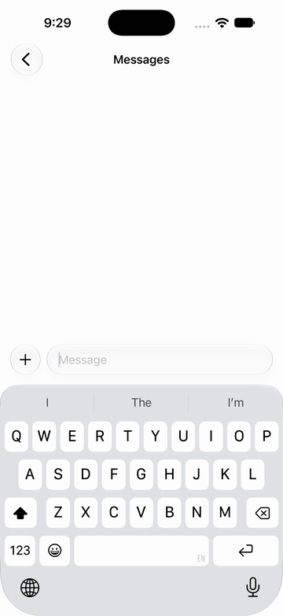
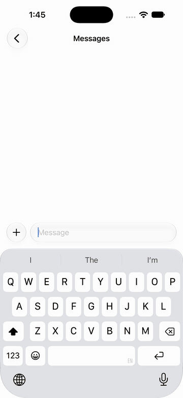

<p align="center">
  
</p>
<h1 align="center">Hielo</h1>

Present morphing Liquid Glass popovers anywhere, including over a frozen iOS
system keyboard.

Hielo is designed for interactions such as glass menus that open
over the keyboard without dismissing it. It also provides a public-API-only
utility for reading the keyboard's height, for example to put a sheet exactly
where the keyboard was.

<table align="center">
  <tr>
    <td align="center">
      
    </td>
    <td align="center">
      
    </td>
  </tr>
  <tr>
    <td align="center"><code>hieloPopover</code> over the keyboard</td>
    <td align="center"><code>onHieloKeyboardHeightChange</code> sizing a sheet</td>
  </tr>
</table>

Both recordings are the example app running in Simulator.

| API | Purpose |
| --- | --- |
| `.hieloHost()` | Hosts popovers for a page. |
| `.hieloPopover(isPresented:attachmentAnchor:sourceShape:popoverShape:onDismiss:content:)` | Presents a morphing glass popover from a source view. A second overload adds `sourceGlass:`. |
| `.hieloPopoverStyle(_:)` | Chooses a `.glass` (default) or `.plain` source. |
| `.hieloPopoverAnimation(_:)` | Sets the opening, dismissal, and snap-back animation. |
| `.onHieloKeyboardHeightChange(_:)` | Reports `HieloKeyboardHeight` (`current`, `lastVisible`). Public API only. |

> [!WARNING]
> Presenting a popover over the keyboard uses private UIKit: remote
> keyboard-window lookup, input host-view lookup, and keyboard view
> snapshotting, lightly obfuscated. An app that ships it may be rejected by App
> Review, and it can break in any iOS update. Use at your own risk. The
> keyboard-height utility (`onHieloKeyboardHeightChange`) uses only public API.

## Requirements

- iOS 26 or later
- Swift 6.2 or later
- Xcode 26 or later

## Installation

In Xcode, choose **File → Add Package Dependencies** and enter:

```text
https://github.com/laurasandoval/Hielo
```

## Present a popover

Apply `.hieloHost()` to the containing page and `.hieloPopover` to its source
view. Size the expanded content with normal SwiftUI layout modifiers:

```swift
import Hielo
import SwiftUI

struct ChatView: View {
  @State private var isMenuPresented = false
  @FocusState private var inputIsFocused: Bool

  var body: some View {
    VStack {
      Spacer()

      Button("Open menu", systemImage: "plus") {
        isMenuPresented = true
      }
        .frame(width: 48, height: 48)
        .hieloPopover(
          isPresented: $isMenuPresented,
          attachmentAnchor: .leading
        ) {
          Text("Hello World")
            .frame(width: 250, height: 250)
        }

      TextField("Message", text: .constant(""))
        .focused($inputIsFocused)
    }
    .hieloHost()
  }
}
```

The modifier supplies the Liquid Glass surface. Both the source and expanded
content can contain any SwiftUI view. Expanded content can hug its content or
set a fixed size with `frame`; no package-specific sizing style is required.
When the keyboard is visible, the popover freezes it and presents above its
snapshot. Without a keyboard, the same popover presents in the app window.

The default transition expands from a capsule into a continuously rounded
rectangle with a 32-point corner radius. Customize both ends with familiar
SwiftUI-style shapes:

```swift
.hieloPopover(
  isPresented: $isMenuPresented,
  sourceShape: .rect(cornerRadius: 12),
  popoverShape: .rect(cornerRadius: 24)
) {
  SettingsView()
    .frame(width: 280, height: 320)
}
```

For a source that already owns its appearance, including a non-glass source,
pass `sourceGlass: nil`. The expanded popover remains Liquid Glass:

```swift
.hieloPopover(
  isPresented: $isMenuPresented,
  sourceGlass: nil,
  sourceShape: .circle,
  popoverShape: .rect(cornerRadius: 28)
) {
  ProfileActions()
    .frame(width: 240, height: 280)
}
```

`.leading` means leading-center over a keyboard. In the app window, its centered
axis adapts to the source position, becoming top-leading or bottom-leading so
the popover expands into the available space. `.trailing`, `.top`, and `.bottom`
adapt the same way. Explicit corners such as `.bottomTrailing`, as well as
custom unit points, remain supported. The real text input stays focused when
one is active. Taps outside dismiss the popover, and the expanded surface can be
dragged in any direction. Only a downward release dismisses it.

When expanded content would cross an edge, the popover translates into the
available safe area without changing its natural size. Content larger than the
safe area pins to its leading or top edge. Hielo never resizes the
consumer's view to prevent overflow.

Popover content mounts once per presentation, so its local state resets when
reopened. Keep persistent state in the parent or a model. The source's environment
is copied when the popover opens; later ancestor environment changes are not
forwarded automatically. Use bindings or observable models for changing data,
and set `isPresented` to `false` to dismiss.

## Presentation lifecycle

The host owns its session automatically. Dismissing the popover or removing its
source cleans up the presentation. Taps outside, including on navigation
controls, dismiss the popover without activating the control underneath.

When keyboard capture is unavailable, the popover falls back to the app window.
If the source or host cannot be resolved, the presentation binding resets to
`false`. Private-runtime checks are best-effort: an incompatible implementation
can still fail at runtime.

To run something after the popover has finished dismissing and its source is
back, such as presenting a sheet, pass `onDismiss`, as with SwiftUI's `sheet`:

```swift
.hieloPopover(isPresented: $isMenuPresented, onDismiss: showPhotos) {
  MenuContent()
}
```

`onDismiss` runs once per dismissal, however the popover was dismissed. A
popover presented over the keyboard also ends if the keyboard is dismissed
underneath it, for example when focus is cleared programmatically.

## Popover styles

Popovers default to a glass source. Apply `.hieloPopoverStyle(.plain)`
after `.hieloPopover(...)` for an inline button without its own glass.
The presented popover still uses glass. A style can also be inherited from
an ancestor. Passing `sourceGlass` explicitly overrides the inherited style.

```swift
Button("Attach", systemImage: "paperclip") {
  isMenuPresented = true
}
.hieloPopover(isPresented: $isMenuPresented) {
  AttachMenu()
    .frame(width: 240, height: 280)
}
.hieloPopoverStyle(.plain)
```

## Animation

Use `.hieloPopoverAnimation(.spring(duration: 0.4, bounce: 0.2))` after the
popover modifier or on an ancestor to customize opening, dismissal, and drag
snap-back. The default is `.spring(duration: 0.3, bounce: 0.2)`. Pass `nil` to
disable animation. The choice is captured at presentation time; Reduce Motion
also disables transitions. Supply a finite animation so dismissal can complete.

## Keyboard height

`onHieloKeyboardHeightChange` reports the height of the docked software
keyboard. It is independent of the popover runtime and uses only public API
(UIKit's `keyboardLayoutGuide`), so it is safe to ship on its own.

`HieloKeyboardHeight` has two values: `current`, which is `0` when no docked
keyboard is showing, and `lastVisible`, which keeps the last nonzero height
after the keyboard is dismissed. Store the value in `@State` and use
`lastVisible` to size whatever replaces the keyboard:

```swift
struct ChatView: View {
  @State private var keyboard = HieloKeyboardHeight()
  @State private var isMenuPresented = false
  @State private var isPhotosPresented = false
  @FocusState private var inputIsFocused: Bool
  let bottomInset: CGFloat  // the window's bottom safe-area inset

  var body: some View {
    Composer(focus: $inputIsFocused) {
      Button("Open menu", systemImage: "plus") { isMenuPresented = true }
        .hieloPopover(isPresented: $isMenuPresented, onDismiss: showPhotos) {
          Menu()
        }
    }
    .onHieloKeyboardHeightChange { keyboard = $0 }
    .sheet(isPresented: $isPhotosPresented) {
      PhotosView()
        // Detents are measured inside the sheet's safe area.
        .presentationDetents([.height(keyboard.lastVisible - bottomInset), .large])
    }
    .hieloHost()
  }

  // A sheet can't appear above the live keyboard, so trade one for the other.
  private func showPhotos() {
    inputIsFocused = false
    isPhotosPresented = true
  }
}
```

Heights are in points and are the keyboard's full height, measured from the
bottom edge of the window. The keyboard covers the bottom safe area, but a
sheet detent is measured above it, so subtract the bottom safe-area inset to
size a sheet that should match the keyboard.
`lastVisible` is `0` until a keyboard has appeared, so supply a fallback height
for that case.

Floating, undocked, and split keyboards report `0`, and with a hardware
keyboard only the docked shortcuts bar, if shown, reports an overlap. The
action runs when the value changes, with the keyboard's target height, not once
per animation frame; animate dependent layout yourself.

To keep a composer exactly where it sat above the keyboard while a sheet takes
the keyboard's place, drive its bottom inset from one value in both states.
`MessagesDemoView` in the example app shows the full pattern.

## Release scope

The first release exposes `.hieloPopover`, `.hieloPopoverStyle`,
`.hieloPopoverAnimation`, and `.hieloHost()`, with `HieloPopoverStyle` and
`HieloPopoverShape` for customization, and `onHieloKeyboardHeightChange` with
`HieloKeyboardHeight`. Session and source machinery are internal. See
[CHANGELOG.md](CHANGELOG.md) for what each release contains.

## Example app

Open `Examples/HieloDemo/HieloDemo.xcodeproj` to run the Messages demo: a
morphing glass menu over the keyboard. Photos is the one working row; tapping
any other row fades the rest out and back in as a hint. Tapping Photos
collapses the popover, then presents a sheet sized to the keyboard's height
with an inline `PhotosPicker`, which needs no photo-library permission. The
composer stays in place as the sheet replaces the keyboard, and tapping the
text field brings the keyboard back. Keyboard snapshot behavior must also be
verified on a physical iPhone because Simulator keyboard windows can differ.

For device builds, create `Examples/HieloDemo/Signing.local.xcconfig` with
`DEVELOPMENT_TEAM = YOUR_TEAM_ID`. This file is ignored by Git and is loaded
for both Debug and Release. Simulator builds do not require it.

### Reading the demo code

The app in `Examples/HieloDemo` consumes the local package in
`Sources/Hielo`; demo helpers are not part of the package.

- `App/DemoAppView.swift`: the demo's entry view.
- `Demos/Messages/MessagesDemoView.swift`: integration with a separate glass
  button, `onDismiss` sequencing, the Photos sheet, and the keyboard height
  that sizes the sheet and holds the composer in place.
- `Demos/Messages/MessagesDemoPhotoPicker.swift`: the inline photo picker.
- `Demos/Messages/MessagesDemoMenu.swift`: the menu content, including the
  fade that hints at Photos when another row is tapped.
- `Helpers`: shared composer layout and button styling.

Paths above are relative to `Examples/HieloDemo/HieloDemo`.

## License

Hielo is available under the MIT License.

The Messages icons and artwork used in the demo app are the property of Apple
and are included for demonstration only. They are not covered by the MIT
license.
